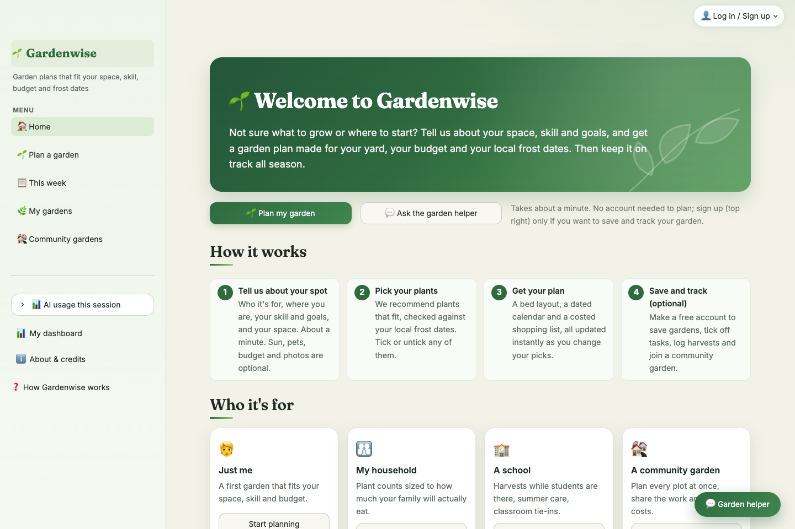

# 🌱 Gardenwise

**Garden plans that fit your space, skill, budget and frost dates.**

Gardenwise turns a one-minute form, or one sentence to its garden helper, into a garden plan for the
contiguous US: the right plants, a bed layout, a dated calendar built from your local frost dates, and a
costed shopping list. AI picks the plants; **code checks every pick** against a plant database and your
frost data before you see it. Save a garden to tick off tasks, log harvests in one tap, and plan next
season with crop-rotation tips. The same engine scales up to **households, school gardens and whole
community gardens** (join codes, roles, CSV import of members, shared work days, pooled costs).

Course project for *AI Foundations* (Yale SOM). Model: `gpt-6-luna` via Portkey. Report: [`report.html`](report.html) · slides: [`slides.html`](slides.html).



---

## Run it locally (about 5 minutes)

You need **Python 3.11 or newer** (tested on 3.14) and a terminal.

1. **Get the code** and open a terminal in the repo folder:
   ```bash
   git clone https://github.com/jgonsalves08/gardenwise.git
   cd gardenwise
   ```
2. **Create a virtual environment and install** the requirements:
   ```bash
   python3 -m venv .venv
   source .venv/bin/activate          # Windows: .venv\Scripts\activate
   pip install -r requirements.txt
   ```
3. **Add an API key.** The app reads a `.env` file from **this repo folder first, then the folder above it**,
   so the course's shared `.env` one level up works as is. It needs one of:
   ```
   PORTKEY_API_KEY=...      # course key (Portkey gateway, gpt-6-luna)
   OPENAI_API_KEY=...       # or your own OpenAI key
   ```
   See `.env.example`. The real `.env` is gitignored and never committed.
4. **Start the app:**
   ```bash
   streamlit run app.py
   ```
   Open **http://localhost:8501**. On first start the app creates a local database (`garden.db`) with
   the test accounts below.

No other services, keys or downloads are needed: all data (plants, 111 reference cities, prices, plant
photos) ships in `data/`.

---

## Test accounts (local copies only)

These accounts exist only in the local database each clone creates; they are **not** shown anywhere on
the website. All use the password **`gardenwise-test-2026`**. For a public deployment, turn them off
with `GARDENWISE_TEST_ACCOUNTS=0`. Passwords are stored only as salted PBKDF2 hashes, so knowing a
test password doesn't reveal anyone else's.

| Log in as | User type | What's already there |
|---|---|---|
| `demo` | **Showcase** (start here to show someone the app) | A New Haven gardener with a bit of everything: a backyard bed with last year's season + this fall's (rotation tip), a kitchen windowsill, last summer's balcony tea pots, next spring's front-yard flowers, and **Plot 4 at Elm Street Community Garden** as an admin; harvest history throughout |
| *(no login)* | **Guest** | Plan any garden; save is the only thing that needs an account |
| `test_individual` | **Individual** | New Haven backyard bed with 2 seasons (crop-rotation tip), indoor kitchen windowsill, finished patio containers, a future cabin garden in **Boise, ID**; harvest history |
| `test_household` | **Household** (2 adults, 2 kids, dog) | Atlanta, GA in-ground family salsa garden, sized to how much they eat |
| `test_school` | **School / classroom** (grades 3–5) | Minneapolis, MN classroom beds: last spring's season + this fall's, with classroom tie-ins |
| `test_organizer` | **Community organizer** | Runs *Elm Street Community Garden* (New Haven): 4 plots, work days, cost split |
| `test_admin` | **Community admin** | Admin at Elm Street (has Plot 2) **and** organizer of *Rainier Valley Community Garden* (**Seattle, WA**) |
| `test_member` | **Community member** | Member of both gardens with claimed plots; sees totals only |

To start over with fresh test data: stop the app, delete `garden.db`, start it again.

### Things to try

- **Guest:** Home → *Plan my garden* → fill the 7 steps (try ZIP `60601` Chicago, `98101` Seattle,
  `30303` Atlanta) → untick a plant and watch the layout/calendar/costs update → download the calendar
  (.ics), printable plan or budget sheet. Try ZIP `33101` (Miami) to see the hot-climate *limited support*
  message.
- **Garden helper** (💬 bottom right): "I live in Denver and want a salsa garden in a 4 by 8 bed" (it fills
  the form), "How much have I harvested?" (when logged in), "Move planting the garlic to Nov 2" (needs
  Confirm).
- **Individual:** My gardens → *Backyard bed* → season switcher, rotation tip, 📅 move a task date,
  *Mark as finished* (choose done vs skipped), *Plan next season here*. My dashboard → filters.
- **School:** open the classroom beds → *Plants in this garden* shows a classroom tie-in per crop.
- **Organizer / admin / member:** Community gardens → open a garden → compare the tabs each role sees
  (only organizers/admins see the join code, Settings and CSV import; only the organizer can delete).
- **Photos:** Plan a garden → step 7 → add `tests/fixtures/yard_injection.jpg` (a yard photo with written
  "instructions" in it) → the Site Scout flags the text and ignores it.

---

## How it works

| Agent | Type | Job |
|---|---|---|
| **Intake** | AI | Turns the optional chat note into strict fields (goals, wants/avoids, pets, sun); ≤ 2 follow-up questions |
| **Site Scout** | AI (vision) | Reads 1–3 photos for surface, sun and hazards (lead paint, black walnut, drainage); you confirm each finding |
| **Selector** | AI | Picks 3–6 plants + alternates from code-filtered candidates; returns database IDs only |
| **Verifier** | Code | ~35 checks: zone, sun, skill, space, frost-based dates, school year, goals, rotation, pets, lead; one retry, then removes failing picks |
| **Calendar** | Code | Sow/transplant/harvest dates from local frost data; editable per task |
| **Build advisor** | AI + code | AI picks optional builds; code computes every quantity and price and enforces the budget |
| **Garden helper** | AI + tools | Chat that answers from the data, fills the form, opens pages, and *proposes* changes that need Confirm |

Flow: Intake (optional) → Selector ⇄ Verifier → Calendar → Build advisor. Every AI call goes through
`garden/llm.py`, which checks a per-session token/call budget first and logs input, cached and output
tokens, latency and cost to `logs/usage.jsonl` (shown in the sidebar's *AI usage* panel).

**Coverage:** 111 reference cities in all 48 contiguous states + DC; every ZIP prefix maps to one.
Places where it rarely freezes are marked *limited support* and planning is off there for now, because
their season is set by summer heat, not frost: all of Florida, the Gulf and southern Atlantic coast, south and
central Texas, the low deserts (Phoenix, Tucson, Las Vegas, Palm Springs) and most of California outside the
mountains (23 of the 111 cities).

---

## Tests, costs and evidence

```bash
pytest tests/test_core.py          # 38 offline tests: data, calendar, verifier, roles, privacy, exports, personas
pytest tests/test_injection.py     # 14 attacks (10 need the API key); writes results/injection_results.md
python scripts/cost_benchmark.py   # 10 plans cold vs warm cache; writes results/cost_*.{csv,md}
python scripts/compare_baseline.py # Gardenwise vs a plain prompt, same checks; writes results/baseline_*.{csv,md}
python scripts/effort_ab.py        # reasoning effort low vs medium, 40 plans; writes results/effort_*.{csv,md}
python scripts/take_screenshots.py # app must be running; saves screenshots/ for every persona
```

Latest results (see `results/`):
- **Injection & abuse:** 14/14 defenses held (prompt leaks, fake system tags, CSV formula + note
  injection, text inside photos, unconfirmed writes, budget drain, addresses, role escalation).
- **Cost:** ~$0.00042 per plan with prompt caching (37% less than cold), ~$0.00013 per helper message;
  about **$29/month for 10,000 active users**; a 40-plot community garden plans for about 2 cents.
- **Reasoning effort:** low vs medium on the same 10 profiles (40 plans): same quality (100% pass, every
  plant checked), medium cost ~25% more and ran several times slower, so Gardenwise uses low.
- **vs. a plain prompt (same model):** plants passing every check 72% → **100%**; plans with zero problems
  0/10 → **10/10**; lead-in-soil warning 2/10 → **10/10**.

---

## Project structure

```
app.py                  Streamlit entry point (navigation, sidebar, account menu, helper)
garden/agents/          intake, selector, calendar, build advisor, site scout, helper
garden/verifier.py      code checks on every AI pick
garden/pipeline.py      recommend() (AI) and assemble() (code-only plan building)
garden/store.py         SQLite: accounts, gardens & seasons, checklists, harvests, community gardens
garden/community.py     CSV import, batch planning, work days, pooled costs, garden-wide stats
garden/exports.py       .ics calendar, printable plan, Excel budget sheets
garden/views/           one module per page
data/                   plants.json, locations.json, builds.json, plant_images/ (+ credits.json)
tests/  scripts/  results/  screenshots/
```

## Troubleshooting

- **"No API key found"**: put `PORTKEY_API_KEY` in `.env` in this folder or the folder above it.
- **Port 8501 in use**: `streamlit run app.py --server.port 8502`.
- **Reset test data**: stop the app and delete `garden.db`.

## Credits

Plant photos: Wikimedia Commons (CC / public domain); authors and licenses in
`data/plant_images/credits.json` and on the app's *About & credits* page. Frost and zone data: USDA 2023
Plant Hardiness Zone Map, NOAA 1991–2020 normals. Plant data: state Cooperative Extension guides;
pet toxicity: ASPCA. Prices are estimates as of fall 2025.
